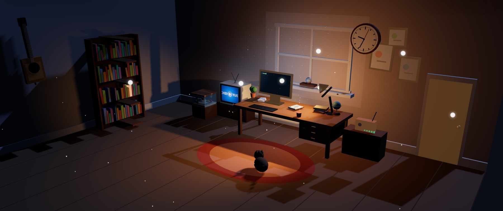

# ChenQiyue 的书房

**一间会呼吸的屋子 —— 你可以在浏览器里推门进去。**

[](https://chenqiyue.ccwu.cc/)
[](#工程上的讲究)
[](#工程上的讲究)
[](#三十秒先看个片子)
[](LICENSE)

一个纯手搓的个人网站。**门厅是 2D 的**，推门进去是一间 **Three.js 手写的 3D 书房**，屋里每件东西都能点；首页还藏着一支 **30 秒的代码生成短片**。

没有框架、没有构建步骤、没有一张图片素材，主体是**一个 HTML 文件**。

> 🌐 **在线体验：<https://chenqiyue.ccwu.cc/>** —— 手机也能进，拖动环顾，点发光的物件。

---

## 目录

- [三十秒，先看个片子](#三十秒先看个片子)
- [这是什么](#这是什么)
- [截图](#截图)
- [屋里的小东西](#屋里的小东西)
- [房间里的物件](#房间里的物件)
- [工程上的讲究](#工程上的讲究)
- [技术栈](#技术栈)
- [仓库结构](#仓库结构)
- [本地运行](#本地运行)
- [访客计数器](#访客计数器)
- [部署](#部署)
- [作品区的自动同步](#作品区的自动同步)
- [已知限制（说实话）](#已知限制说实话)
- [许可证](#许可证)

---

## 三十秒，先看个片子

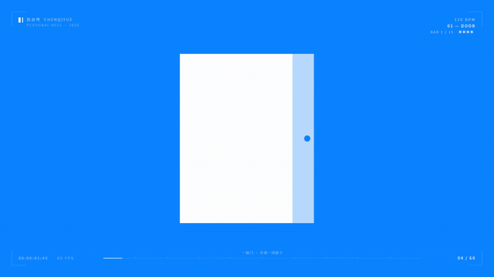

**《一扇门，开成一间屋子》** —— 30 秒 / 120 BPM / 十个场景 / 60 fps。

没有一个剪辑软件参与：画面是一个 HTML 文件里**逐帧算出来**的，音轨是 **Web Audio 合成**的。
一个字体、三种颜色、每拍一个动作，每一场都由上一场变形而来；首帧和末帧是同一条线，所以它能一直循环。

👉 [**在网站里看（有声音）**](https://chenqiyue.ccwu.cc/#reel) · 👉 [**在 3D 房间的电视里看**](https://chenqiyue.ccwu.cc/)（推门进去，点电视）

<details>
<summary>短片是怎么做的（点开）</summary>

- 画面：`reel/reel30.html`，单文件 1920×1080。所有样式由 `window.seek(t)` 这个**纯函数**算出来 —— 没有 CSS 动画、没有计时器、没有跨帧状态，所以任意一帧都能独立重现。
- 渲染：Playwright 驱动页面，逐帧截 **1800 张 PNG**（60 fps × 30 s），每帧再取 3 个子帧做快门运动模糊；ffmpeg 编码。
- 声音：`reel/audio30.mjs` 用 `OfflineAudioContext` 合成 —— 4/4 底鼓、侧链压缩、16 分音符 hats、A 小调贝斯线、三音动机在四个节点重现，直接写出 WAV。
- 源码都在 [`reel/`](reel/)，重渲命令见 [`reel/README.md`](reel/README.md)。

</details>

---

## 这是什么

不是一页简历式的个人主页，而是"一间屋子"：

| | |
|---|---|
| 🚪 **门厅** | 进入时的 2D 落地页：我是谁、在折腾什么、做过什么。右边那扇门就是入口。 |
| 🏠 **推门进去** | 切到 3D 房间，拖动环顾、缩放、点屋里的东西。 |
| 📺 **屋里每件东西都有故事** | 挂钟、鱼缸、吉他、电视、地球仪、纸飞机、窗台气象、桌上那叠手稿…… |
| 🎬 **一支短片** | 首页第一屏之下，以及 3D 房间那台电视里，都在放这 30 秒。 |
| 🐱 **藏了彩蛋** | 可探索的秘密（右上角有发现进度）、一只会散步的猫、一个"抓 Bug"小游戏。 |
| 📊 **真实的访客计数器** | 右下角那个数字是真的人在访问时才增长，不是假数据。 |

---

## 截图

| 门厅（2D） | 3D 房间（夜） |
|---|---|
| 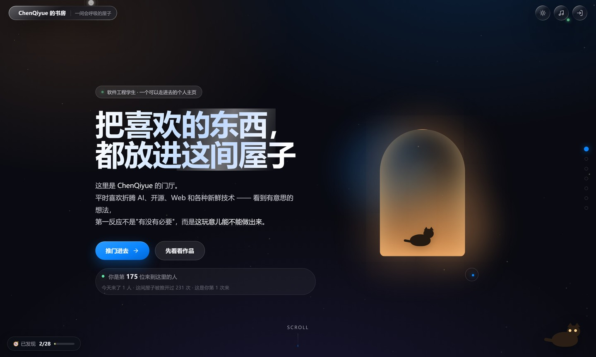 | 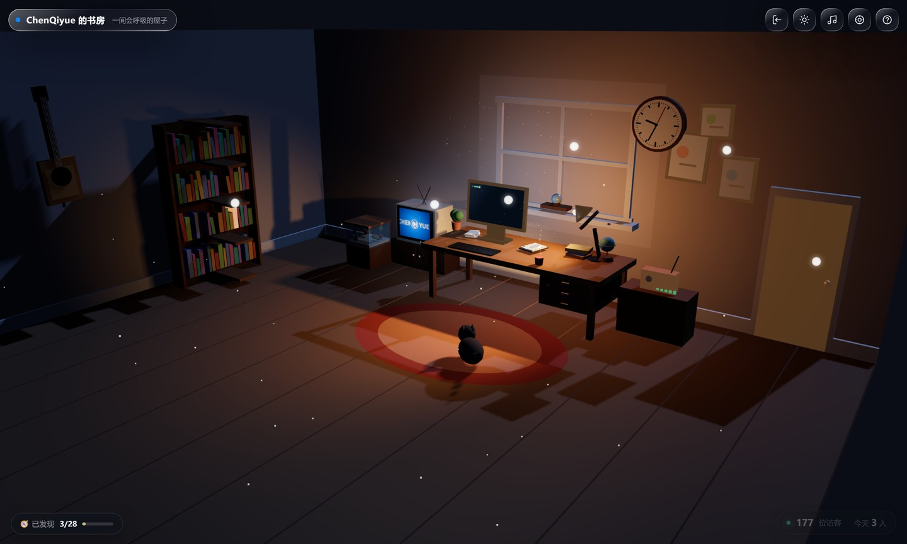 |
| **短片区块** | **点电视：就地播放** |
| 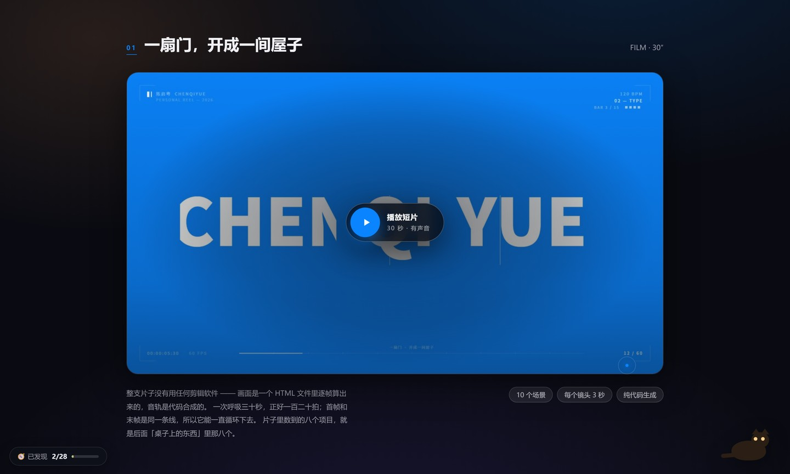 | 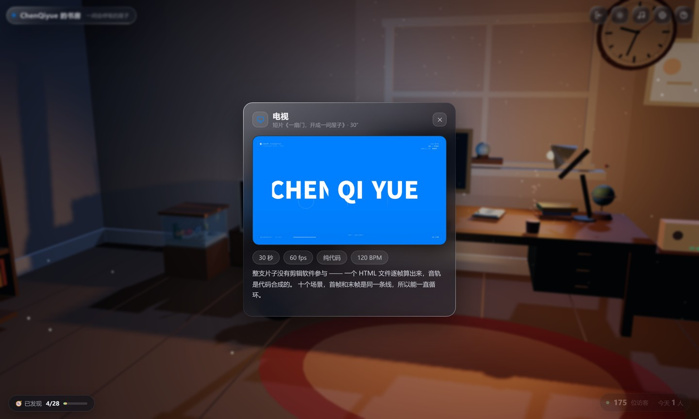 |

**开灯之后** —— 同一间屋子，白天是另一个样子（点窗户或右上角 ☀ 切换）：

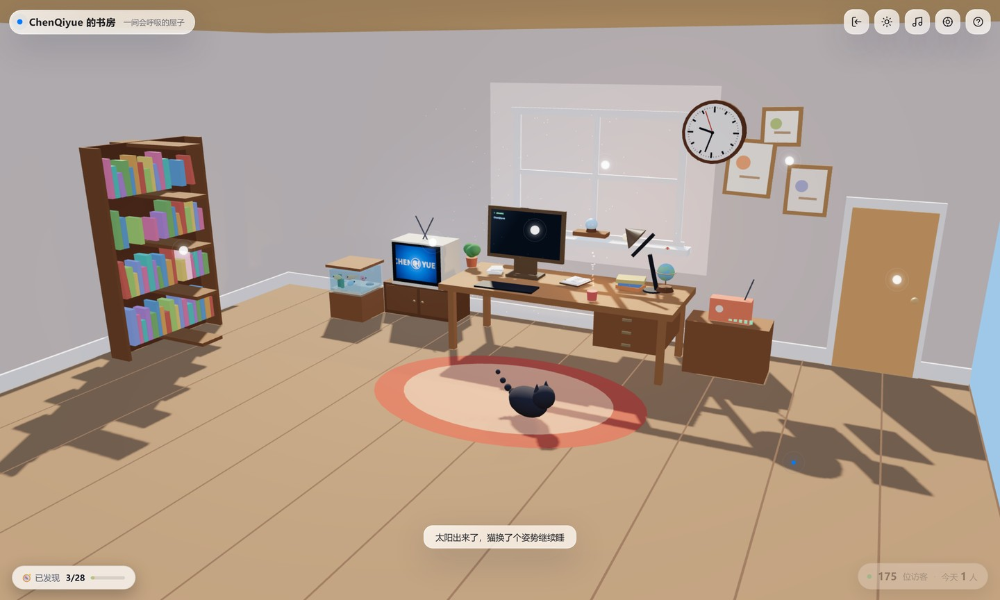

**移动端** —— 门厅 / 短片 / 3D 房间：

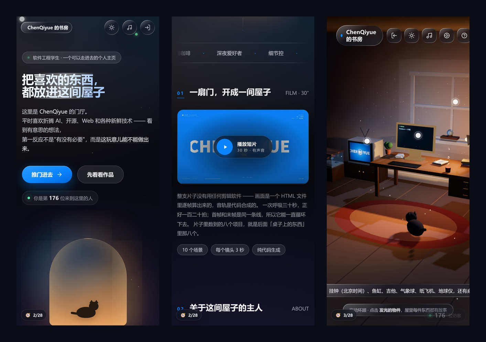

**门厅的其他角落** —— 作品卡片 / 书架：

| 桌子上写着的东西 | 架子上的书 |
|---|---|
| 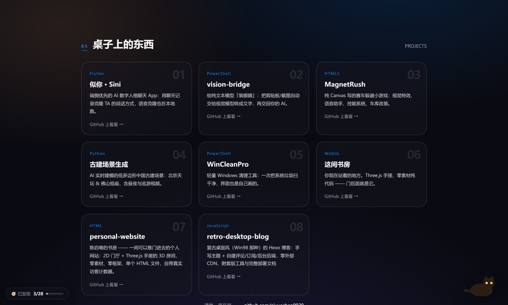 | 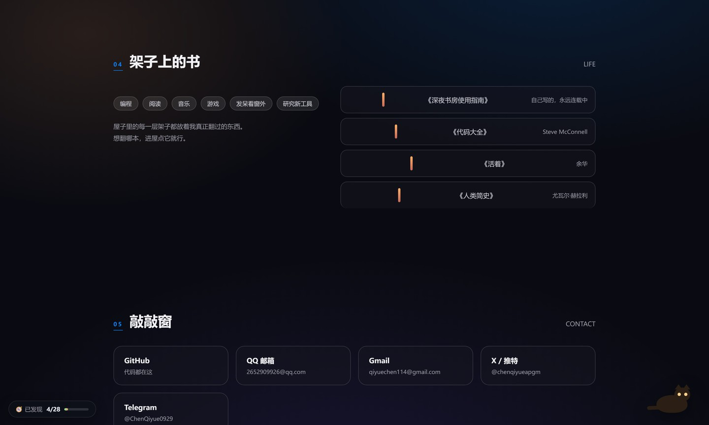 |

---

## 屋里的小东西

镜头推到近处，每件东西都是程序化建模的 —— 没有一张贴图、没有一个模型文件。

| 挂钟：指针按北京时间走 | 地球仪：转去一座城，报距离和时差 |
|---|---|
| 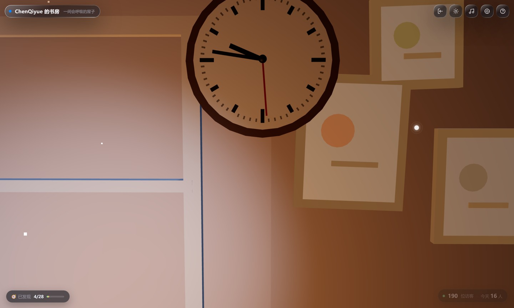 | 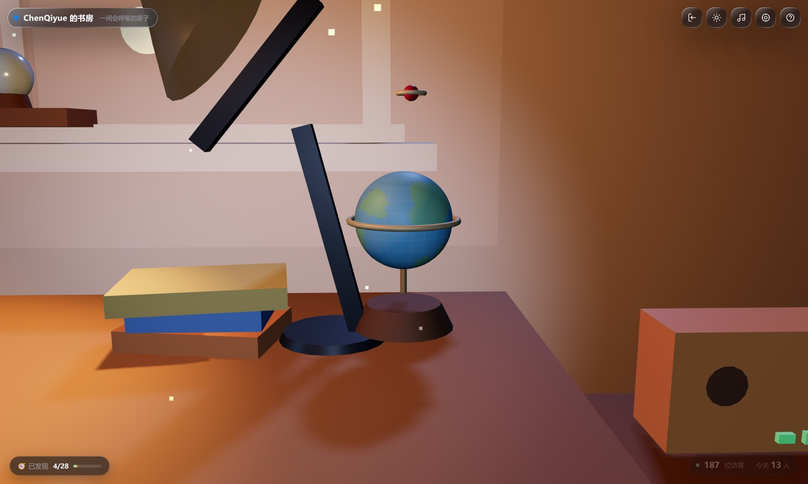 |
| **鱼缸：撒一把鱼食，它们会抢** | **电脑：打开是作品清单** |
| 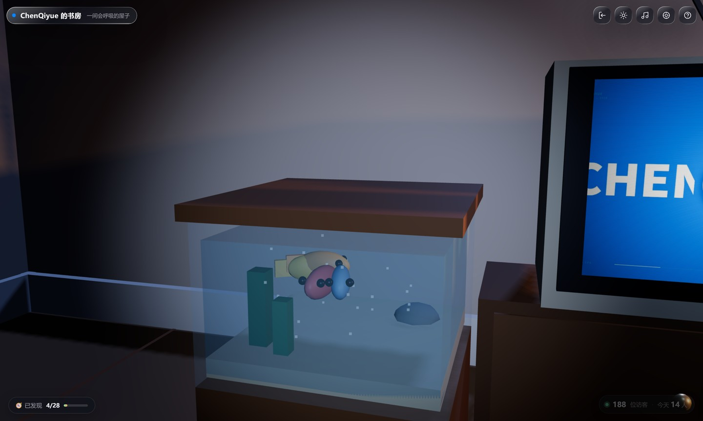 | 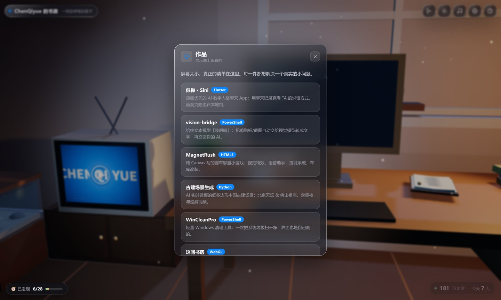 |

**还有一处藏起来的** —— 右上角那个「已发现」徽章。点开是一张清单：屋里 28 个能点的地方、几处彩蛋，还有一个「抓 Bug」小游戏。

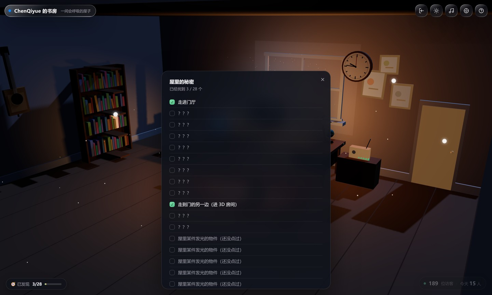

---

## 房间里的物件

| 物件 | 交互 |
|---|---|
| 🕰 **挂钟** | 指针按**北京时间**实时走动（时区无关实现） |
| 🐟 **鱼缸** | 视角推近看鱼，还能撒一把鱼食 |
| 🎸 **吉他** | 能拨响 —— WebAudio 实时合成，没有音频文件 |
| 📺 **电视** | 点开就放那支 30 秒短片；关掉时画面**定格在屏幕上**，再点从断点继续 |
| 🌍 **地球仪** | 随机去一个城市，显示**距离 + 当地时间 + 时差** |
| ✈️ **纸飞机** | 桌上纸堆点一下，飞出一架 |
| 🌦 **窗台气象** | 点一下看天气 |
| 📜 **桌上手稿** | 我的博客，点开跳过去 |
| 🐈 **猫** | 撸一下会喵 |
| 🖥 **电脑** | 作品清单 |
| 🖼 **相框** | 关于我 |
| 🚪 **门** | 联系方式（推门有敲门声和吱呀声） |

还有 **探索进度**（右上角有个 `已发现` 计数，把屋子翻一遍能集齐）和一个可以玩的 **「抓 Bug」** 小游戏。

---

## 工程上的讲究

- **零素材**：界面里没有一张图片、一个音频文件 —— 全部 CSS / Canvas / WebAudio / 程序化贴图。
  唯一的媒体是那支短片，而它也是代码生成的（成品 5 MB，**不点播放一个字节都不下载**）。
- **零依赖、零构建**：除 `vendor/three.min.js` 外没有运行时依赖，没有打包器。
  改完 `index.html` 刷新即可，部署就是传文件。
- **首屏轻**：`index.html` 225 KB，**brotli 后 61 KB**（Three.js 单独本地托管，gzip 155 KB）。
- **后端也是零依赖**：`server/server.mjs` 只用 Node 内置 `http` / `https` / `zlib` —— 没有 express。
  HTML/JS 走 gzip/brotli + ETag 304，**206 分段响应**（iOS 拖进度条要靠它）。
- **HTTPS 自动续期**：acme.sh 走 **DNS-01**（不需要 80 端口、不需要备案），
  服务进程每 12 小时自检，续签后**热加载证书**，不重启。
- **可访问性与兜底**：WebGL 不可用时给提示而不是白屏；尊重 `prefers-reduced-motion`；
  每个物件都有 `aria-label`，键盘也能玩。
- **移动端**：≤760px / ≤430px 单独处理过，触摸手势、底部抽屉面板、视频 `playsinline` 不劫持全屏。

---

## 技术栈

| 层 | 用了什么 |
|---|---|
| 界面 | 原生 HTML + CSS（自定义 design token + `.glass` 毛玻璃材质）+ 原生 JS |
| 3D | Three.js r152（本地 vendor，不用 CDN） |
| 短片 | Canvas 2D 逐帧纯函数 + Playwright 截图 + ffmpeg 编码 |
| 音频 | WebAudio API 实时合成（吉他、音效、整条短片音轨） |
| 后端 | Node.js 原生 `http`/`https`，**零依赖** |
| 部署 | nginx 静态托管 + 一个 Node 进程（计数接口）+ Let's Encrypt（DNS-01） |

---

## 仓库结构

```
.
├── index.html                 # 网站本体（单文件：2D 门厅 + 3D 房间 + 全部样式/逻辑）
├── vendor/
│   ├── three.min.js           # Three.js r152（本地托管）
│   └── reel/                  # 短片成品：1080p / 720p / 封面（懒加载）
├── reel/                      # 短片渲染工程（源码，可重渲）
│   ├── reel30.html            #   画面：单文件 Canvas，window.seek(t) 纯函数
│   ├── render30.mjs           #   逐帧截图 1800 张
│   ├── audio30.mjs            #   合成 30 秒音轨
│   └── README.md              #   重渲步骤与"片子语法"
├── server/
│   ├── server.mjs             # 访客计数 + 静态托管 + gzip/brotli + HTTPS + 自动续期
│   └── README.md
├── src/                       # 模块化源码分片（开发时注入进 index.html）
│   ├── site.css / site.js / site.html
│   └── build.mjs              # 注入 + 语法自检构建脚本
├── tools/
│   ├── sync-projects.mjs      # 作品区跟着 GitHub 自动更新
│   └── sync-projects.config.json
├── docs/
│   ├── DEPLOY.md              # 部署到服务器的完整步骤
│   ├── screenshots/
│   └── media/                 # 早期演示视频
├── .github/workflows/         # 每天自动同步作品区
├── LICENSE
└── README.md
```

---

## 本地运行

### 只看前端

```bash
npx serve .          # 或 python -m http.server 8080
```

> 直接双击 `index.html` 也能看，只是浏览器会限制一部分特性（比如剪贴板、自动播放）。
> 资源用的是**相对路径**，放在任何子路径下（例如 `https://user.github.io/repo/`）都能跑。

### 连上访客计数后端

```bash
node server/server.mjs        # 默认 8790 端口，同时托管网站 + /api/hit

# 可选环境变量：
#   PORT=6061
#   SITE_DIR=/path/to/site
#   DATA_FILE=./data/visits.json
#   TLS_DIR=<SITE_DIR>/.certs   # 放了 fullchain.pem + privkey.pem 就自动启用 HTTPS
```

---

## 访客计数器

浏览器首次访问时生成一个随机 ID 存在 `localStorage`，之后每次带着它。
服务器**只对没见过的 ID 计数**，见过的只加次数。

| 页面显示 | 含义 | 是否去重 |
|---|---|---|
| 你是第 N 位来到这里的人 | 累计访客 | ✅ 按浏览器去重 |
| 今天来了 N 人 | 当日访客 | ✅ |
| 这间屋子被推开过 N 次 | 总访问次数 | ❌ |
| 这是你第 N 次来 | 单个访客的次数 | ❌ |

**隐私**：不存 IP、不做指纹、不接第三方统计，只有"一个随机 ID + 次数"，存在自己的服务器上。

---

## 部署

线上实例跑在一台 **1.6 GB 内存**的轻量云服务器上：nginx 托管静态文件，一个 Node 进程只负责计数接口。

```bash
# 1) 站点文件放到服务器目录（index.html / vendor/ / server/）
# 2) 容器里跑后端
docker run -d --name mysite --restart unless-stopped \
  -p 6061:6061 -v /path/to/site:/site -e PORT=6061 \
  --entrypoint /usr/local/bin/node <node-image> /site/server/server.mjs

# 3) 签发证书（DNS-01，不需要 80 端口、不需要备案）
acme.sh --issue --dns dns_cf -d your.domain --keylength ec-256
```

之后 `server.mjs` 会自动启用 HTTPS，并在每 12 小时自检续期、续签后热加载证书 —— **90 天到期也不用管**。

细节（nginx vhost、只放行必要路径、证书续期钩子）见 [`docs/DEPLOY.md`](docs/DEPLOY.md) 与 [`部署说明.md`](部署说明.md)。

---

## 作品区的自动同步

门厅的「作品」卡片和 3D 房间里的作品面板读的是**同一份数据** —— `index.html` 里的 `projects` 数组。这份数据可以自动跟着 GitHub 走：

```bash
cp tools/sync-projects.config.example.json tools/sync-projects.config.json
node tools/sync-projects.mjs      # 拉 GitHub 仓库 → 改写 projects 数组
```

- 手写的中文名称/简介优先保留，其余（语言、链接）从 GitHub 现取
- 可自动追加**其它有真实简介的仓库**，上限自己定（`maxTotal`）
- **幂等**（没变化不写）、写前自动备份、产物语法校验，**失败绝不覆盖**
- 仓库里还配了 `.github/workflows/sync-projects.yml`：每天 04:10（北京时间）自动跑一次并提交
- 短片里出现了八个项目，脚本每次会核对一遍 `reel.projects` 快照 —— 对不上就在日志里提示「短片需要重渲」

---

## 已知限制（说实话）

1. **计数器需要后端**：纯静态托管（GitHub Pages / 各类 PaaS）上，计数会退化为本地存储 —— 想要真实数字就得连自己的后端。
2. **3D 需要 WebGL**：极老的设备或禁用了 WebGL 的环境下会自动降级为提示，进不了 3D 房间。
3. **短片是"烘焙"好的**：项目列表变了，片子里那八张卡片不会跟着变 —— 同步脚本会提醒你重渲。
4. **非标准端口的国内提示**：用 `域名:6061` 这种形态，部分国内浏览器/App 会提示"危险网站"（是"未备案 + 非常规端口"的策略提示，与证书无关）。要彻底消除需走标准 443。

---

## 许可证

[MIT](LICENSE) © 2026 Chen Qiyue

Three.js 版权归其作者所有（MIT）。短片使用的字体为 Noto Sans SC（SIL Open Font License）。

## 关于我

- GitHub：[@qiyuechen0929](https://github.com/qiyuechen0929)
- X：[@chenqiyueapgm](https://x.com/chenqiyueapgm)
- 博客：[060929.xyz](https://060929.xyz)

如果这间屋子让你觉得有意思，欢迎进来逛逛，或者在右上角点个 ⭐。
